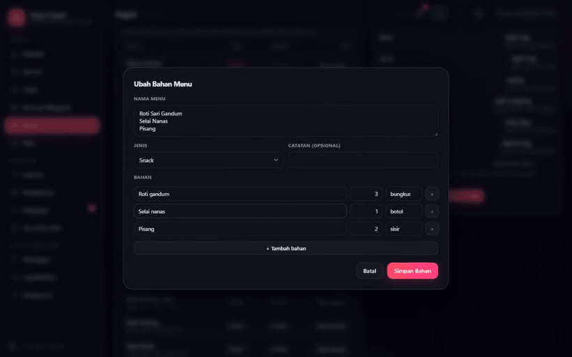
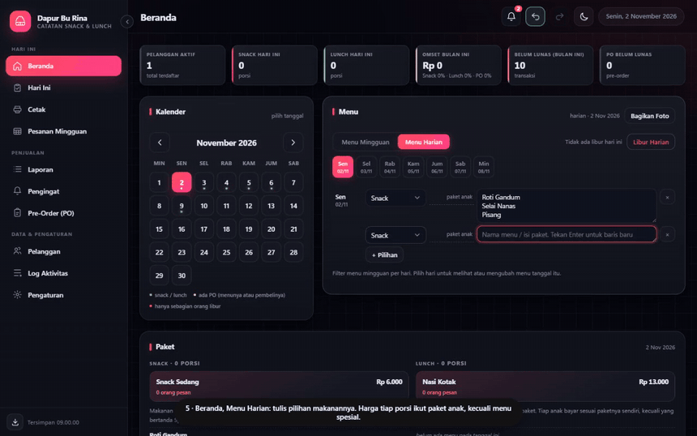

# Catatan Katering

Aplikasi pencatat untuk usaha katering sekolah: snack box dan nasi kotak yang dikirim ke sekolah. Dipakai satu orang, yaitu pemiliknya sendiri, untuk mencatat pesanan, menghitung tagihan, dan menyiapkan kertas untuk dapur. Tidak memakai laptop orang lain, tidak ada server, dan tidak perlu internet.

Cara memakainya: buka `index.html` di Chrome atau Edge. Tidak ada proses install, tidak ada dependensi, tidak ada server yang perlu dinyalakan.

*Cuplikan 14 detik dari tur seluruh halaman (± 91 detik, tanpa suara).*

## Langkah setup

*Cuplikan 14 detik dari langkah Dapur dan Stok.*

Rekaman penuhnya ada di [halaman release](https://github.com/IniEyyy/catatan-katering/releases/tag/preview): `preview.mp4` untuk tur seluruh halaman dan `tutorial.mp4` untuk langkah setup. Keduanya tanpa suara dan bisa diunduh langsung.

1. **Klik dua kali `index.html`.** Yang muncul pertama kali adalah data contoh: 25 anak, 6 paket, pesanan ± 6 minggu, beberapa PO kelompok beserta invoice, dan resep lengkap untuk semua menu mingguannya. Tujuannya supaya semua tampilan bisa langsung dicoba sebelum ada data sungguhan.
2. **Mulai dari kosong.** Buka *Pengaturan › Tampilan & Cadangan Data*, lalu tekan tombol merah **Reset semua data** di bagian bawah kartu itu.
3. **Identitas usaha** ada di *Pengaturan › Informasi Usaha*: nama usaha, tagline, logo, nama bank, nomor rekening, dan atas nama. Nama usaha dipakai di sidebar, stiker, invoice, kertas konfirmasi, dan pesan tagihan. Nomor rekening ikut terkirim di pesan WA lewat placeholder `{rekening}`.
4. **Paket harga** dibuat di *Pengaturan › Paket Harga*, misalnya *Snack Sedang* Rp 6.000 dan *Nasi Kotak* Rp 13.000. Isinya cuma nama dan harga, dan paket melekat pada anak, bukan pada menunya. Jadi satu paket yang sama bisa berisi makanan berbeda tiap hari.
5. **Pelanggan.** Di *Pelanggan › + Tambah Pelanggan* diisi nama, kelas, nama orang tua, No. WA, catatan alergi, dan periode langganan. Angka di depan kelas menentukan jenjang: `3A` berarti SD, `11B` berarti SMA. Kalau periodenya mingguan, bulanan, atau semester, pesanan anak itu langsung terisi ke depan sampai akhir periode, Senin sampai Jumat, dan tanggal libur dilewati. Untuk anak yang hanya beli sehari, pilih status **Beli Sekali** lalu isi tanggalnya. Pesanannya dibuat satu baris pada tanggal itu saja, dan setelah hari itu lewat anak tersebut tidak muncul lagi di daftar "yang berjalan".
6. **Menu.** Buka *Beranda › Menu Harian* (atau *Menu Mingguan*) lalu tekan **+ Pilihan**. Isi makanan ditulis per baris, kemudian jenisnya dipilih: Snack, Snack Spesial, Lunch, Lunch Spesial, atau PO. Baris lunch biasa tidak punya paket maupun kolom harga. Baris snack biasa punya pemilih paket: biarkan **Semua paket** untuk menu umum, atau pilih satu paket kalau makanan itu hanya untuk anak dengan paket tersebut. Harga tetap tidak diketik di baris, karena tiap anak membayar sesuai paket porsinya sendiri. Baris spesial punya kotak harga sendiri yang berlaku untuk semua anak yang memilihnya hari itu. Kalau satu baris dihapus, pilihan anak yang menunjuk baris itu dilepas dan nomor baris di bawahnya ikut bergeser, jadi tidak ada anak yang tiba-tiba mendapat makanan lain.
7. **Dapur.** Buka *Dapur* lalu tekan **Atur resep** pada menu minggu itu. Tulis bahan beserta jumlah dan satuannya, lalu isi **Cara membuat** kalau perlu. **+ Resep** menambah resep menu lain. Semua resep terkumpul di **Daftar Resep** dan bisa dicari lewat nama menu atau bahannya. **Daftar Belanja** menjumlahkan bahan sejenis dan mengurangi stok yang ada. **Jadikan Pengingat Beli** membuka halaman Pengingat dengan isi kekurangannya.
8. **Stok.** Di *Stok* catat bahan dan tempat makan. Tab **Bahan** dan **Tempat Makan** dipisah; tiap item punya stok, satuan, batas minimum, dan status Aman, Menipis, atau Habis. Tombol **+ Stok** menambah jumlah saat belanja datang, dan stok bahan ikut mengurangi daftar belanja Dapur.
9. **Pengeluaran.** Di *Pengeluaran* catat gas, kemasan, transport, gaji, dan biaya lain. Ringkasannya menampilkan pengeluaran bulan itu, omset dibayar, dan laba kotor, plus grafik omset vs pengeluaran enam bulan terakhir.
10. **Pesanan hari ini** dikerjakan di halaman *Hari Ini*. Klik huruf **A/B/C** untuk memilih makanan anak itu (snack boleh lebih dari satu, lunch tetap satu), isi catatan, lalu klik **angka total** untuk mengatur metode bayar atau menandai lunas. Kalau hari itu hanya ada satu makanan, pilihan itu langsung terpakai sendiri begitu anak ditandai pesan, tanpa perlu diklik. Membatalkannya cukup dengan klik hurufnya sekali.
11. **Cetak.** Di halaman *Cetak* pilih tanggal, jenis, dan anaknya. Jenis snack atau lunch dipilih lewat tombol sejajar. Hasilnya stiker A4 untuk ditempel ke kotak bekal, atau kertas konfirmasi untuk satpam. Pilihan **Warna font** dan **Warna tabel** di atas berlaku untuk kedua jenis cetakan, dan kertas konfirmasi bawaannya menampilkan kolom kelas. Kalau tanggal yang dibuka tidak punya pelanggan, halaman otomatis maju ke hari berikutnya.
12. **Menu sidebar.** Di *Pengaturan › Menu Sidebar*, centang halaman yang ingin ditampilkan dan pakai panah untuk mengatur urutannya. Pengaturan selalu tampil agar tidak terkunci.
13. **Cadangkan.** Tekan ikon unduh di kaki sidebar, atau *Beranda › Cetak & Bagikan › Cadangan JSON*. Berkas itu satu-satunya salinan data kalau browser dibersihkan atau laptop diganti.

Semua perubahan tersimpan otomatis di browser yang sama. Jam simpan terakhir terlihat di kaki sidebar, dan setiap aksi tercatat di *Log Aktivitas* lengkap dengan tombol **Urungkan**.

## Logo usaha

Logo diunggah dari *Pengaturan › Informasi Usaha* lewat tombol **Pilih gambar**. Berkas yang diterima PNG, JPG, WEBP, atau SVG. Gambar dikecilkan otomatis ke sisi terpanjang 512 px sebelum disimpan, jadi berkas besar tidak membuat cadangan membengkak; berkas aslinya tidak diubah dan tetap aman di folder asal.

Di bawah unggahan ada pilihan bawaan tempat logo dicetak. **Stiker** menaruh logo di bawah nama anak dan menggantikan teks nama usaha; tingginya menyesuaikan ruang sel, jadi nama dua baris tetap utuh. **Kertas konfirmasi** dan **Laporan & rekap** menaruh logo di kop dokumen A4, dengan tinggi yang diatur lewat angka **Tinggi di kop** (8 sampai 30 mm). **Dokumen PO** berlaku untuk invoice, resi, dan rekap pre-order. Logo tersimpan bersama data lain di cadangan JSON dan tetap tampil tanpa internet.

Saat mencetak, tiap halaman punya centang **Pakai logo** atau **Logo**. Centang itu hanya berlaku untuk cetakan berikutnya dan bawaannya mengikuti pilihan di Pengaturan, jadi logo bisa dilepas untuk satu cetakan tanpa mengubah setelan permanen. Logo yang sama juga tampil di sudut sidebar dan sebagai ikon tab browser. Kalau logo dihapus, sidebar kembali memakai ikon bawaan dan ikon tab mengikuti bawaan browser.

## Dapur

Halaman Dapur mengumpulkan resep untuk menu yang sudah ditulis di Beranda. Pilih minggu lewat tombol tanggal di kiri atas. Kartu **Menu Minggu Ini** mendaftar menu yang muncul pada minggu itu; tombol **Atur resep** membuka resep bahannya, dan **Ubah resep** dipakai untuk mengubah yang sudah ada. Satu bahan ditulis sebagai nama, jumlah, dan satuan (kg, liter, butir, dan seterusnya), dan kolom **Cara membuat** bisa diisi langkah memasak satu baris per langkah. **+ Resep** menambahkan resep menu lain. Nama menu dicocokkan tanpa peduli jenis spesial, huruf besar-kecil, atau susunan barisnya, jadi menu yang sama tidak perlu ditulis dua kali.

Semua resep terkumpul di kartu **Daftar Resep** dengan kotak cari. Pencarian mencocokkan nama menu, catatan, cara membuat, dan nama bahan, jadi kata seperti "ayam" menampilkan semua menu yang memakainya. Angka di kanan judul menunjukkan jumlah resep, atau "x dari y resep" saat pencarian aktif. Baris yang punya cara membuat menampilkan tautan **Cara membuat** yang bisa dibuka dan ditutup.

**Daftar Belanja** menjumlahkan bahan dari semua menu minggu itu. Bahan dengan nama dan satuan sama digabung, misalnya beras dari beberapa menu menjadi satu baris dengan totalnya. Kalau stok bahan sudah diisi di halaman Stok, daftar ini otomatis mengurangi stok yang ada. Baris yang tertutup stok berbunyi **cukup**, dan angka yang disalin atau dikirim ke Pengingat hanya berisi kekurangannya. Tombol **Salin Daftar** menyalin teksnya, dan **Jadikan Pengingat Beli** membuka halaman Pengingat dengan isi dan tanggal yang sudah terisi, tinggal tekan Tambah. Tombol **Pengingat** di setiap baris Daftar Resep melakukan hal yang sama untuk satu menu saja.

**Acak Menu** mengganti menu snack dan lunch biasa dari Senin sampai Jumat dengan menu lain yang punya bahan. Menu spesial, PO, dan akhir pekan tidak disentuh, dan hari libur dilewati. Centang Snack atau Lunch untuk memilih jenis yang ikut diacak. Opsi **Hindari menu yang sama dengan minggu lalu** aktif secara bawaan: aplikasi membaca menu minggu sebelumnya, lalu mengutamakan bahan yang belum dipakai. Kalau pilihan bahan terbatas, menu yang sama dengan hari yang sama minggu lalu dihindari lebih dulu, dan sisa pengulangan disebut di pesan hasil. Matikan centang itu kalau ingin semua bahan boleh terpilih lagi. Hasilnya tetap bisa diubah manual di Beranda dan dicatat di Log Aktivitas.

Halaman ini diletakkan setelah Pesanan Mingguan karena dipakai saat menyiapkan belanja, bukan saat mencatat pesanan. Pintasan **Resep** juga ada di kepala kartu Menu pada Beranda.

## Stok

Halaman Stok mencatat bahan dan tempat makan yang ada di dapur. Dua tab di atas memisahkan **Bahan** dan **Tempat Makan**. Setiap baris berisi nama, satuan, stok saat ini, dan batas minimum. Tombol **+ Bahan** atau **+ Tempat Makan** menambah baris baru, sedangkan **Ubah** dipakai untuk memperbaiki nama, satuan, stok, minimum, dan catatan.

Tombol **+ Stok** di tiap baris adalah jalan cepat saat belanja datang: isi jumlah yang masuk, tambahkan catatan kalau perlu, lalu stok langsung bertambah tanpa membuka form panjang. Status berwarna membantu membaca kondisi: **Aman**, **Menipis** saat stok menyentuh batas minimum, dan **Habis** saat stok nol. Stok dihitung manual, jadi angkanya hanya berubah lewat tambah stok, Ubah, atau hapus. Pemakaian harian tidak memotong stok sendiri.

Stok bahan dipakai halaman Dapur untuk mengurangi daftar belanja. Tempat makan seperti kotak snack, nasi kotak, sendok, gelas, dan kantong dicatat di tab terpisah supaya persiapan kemasan juga terlihat.

Item yang habis atau menyentuh batas minimum ikut muncul di lonceng kanan atas. Klik baris stok di lonceng untuk langsung membuka tab Bahan atau Tempat Makan yang bermasalah.

## Lonceng perhatian

Lonceng di kanan atas mengumpulkan hal yang sedang menunggu: pengingat jatuh tempo, penunggak tagihan, pesanan hari ini yang belum dipilih makanannya, menu hari ini yang belum diisi, dan stok bahan atau tempat makan yang habis atau menipis. Baris stok menyebut nama barangnya, dan klik baris itu membuka tab Stok yang sesuai.

Stok dianggap menipis saat jumlahnya menyentuh batas minimum, dan habis saat jumlahnya nol. Sinyal ini muncul di setiap halaman karena lonceng ada di top bar, jadi barang yang perlu dibeli tidak perlu dicari dulu ke halaman Stok.

## Pengeluaran

Halaman Pengeluaran mencatat biaya operasional di luar belanja bahan: gas, kemasan, transport, gaji, sewa, listrik, dan lain-lain. Setiap catatan berisi tanggal, kategori, nominal, dan catatan singkat. Bulan dipilih lewat tombol tanggal di kiri atas.

Di atas daftar ada empat angka: **Pengeluaran** bulan itu, **Omset Dibayar** dari pesanan yang sudah lunas, **Laba Kotor** yaitu selisih keduanya, dan jumlah **Catatan**. Grafik di bawah membandingkan omset dan pengeluaran enam bulan terakhir. Pengeluaran tidak mengubah tagihan atau pesanan, angka ini hanya ringkasan usaha. Kalau belum ada omset, laba kotor tampil negatif sebesar pengeluaran bulan itu.

## Halaman

| Halaman | Isi |
|---|---|
| Beranda | Kartu ringkasan. Kalender dimulai hari Minggu; hari ini bertanda hijau dan jadi merah begitu tanggalnya dipilih. Di sebelahnya ada editor menu: baris lunch biasa hanya berisi jenis dan nama, baris snack biasa menambahkan pemilih paket (Semua paket atau satu paket), sementara Snack/Lunch Spesial dan PO punya kotak harga sendiri. Tombol Libur Harian/Mingguan ada di kanan. Di bawah kalender ada blok paket harga per jenis beserta daftar menu hari itu, grafik omset bulanan dan harian, tiga donat sejajar (per jenis, porsi snack vs lunch, status pembayaran) dengan legenda di samping masing-masing, daftar belum lunas, dan pusat Cetak & Bagikan. Saat tab Menu Harian dibuka, blok Paket pindah menjadi baris sendiri di bawah menu, sebelum grafik, dan melebar ke samping |
| Hari Ini | Absensi harian, satu baris per anak, snack dan lunch berdampingan. Pilihan makanan A/B/C ditulis dengan nama paket dan harga anak itu di bawahnya; untuk baris spesial tertulis "Spesial · Rp …". Huruf yang menunya khusus paket lain tampil redup dan tidak bisa dipilih, kecuali untuk membatalkan pilihan yang sudah ada. Ada kolom catatan dan total yang bisa diklik untuk mengatur pembayaran. Judul Snack / Lunch / Hari Ini dan baris judul di bawahnya tetap menempel saat tabel digulung, dengan tinggi tabel ±88% layar. Tidak ada kartu statistik di bawah filter, ringkasannya satu baris di judul tabel. Kalau menu tanggal itu belum dibuat, muncul pintasan ke Beranda › Menu Harian. Di nama tiap anak ada tautan "7 hari" yang membuka anak itu di Pesanan Mingguan |
| Pesanan Mingguan | Koreksi pesanan untuk 7 hari sekaligus: paket, pilihan makanan, metode, serta gratis dan kompensasi. Tabelnya setinggi ±88% layar dengan judul kolom menempel, dan judul rata tengah mengikuti isi selnya. Huruf makanan di sel bisa disorot untuk melihat isi lengkapnya. Snack boleh memilih lebih dari satu makanan, lunch tetap satu. Tanggal pada judul kolom bisa diklik untuk membuka Hari Ini tanggal itu, dan tombol Atur menu melompat ke Beranda › Menu Mingguan minggu tersebut. Hari yang belum punya menu menampilkan **+ buat menu** yang langsung membuka Menu Harian tanggal itu. Tombol Cetak tabel membuka pilihan centang, keterangan atas, warna font, ukuran font, dan warna tabel (per hari, selang-seling per hari, atau selang-seling per pilihan A/B/C). Pratinjau A4 di sebelahnya bawaannya 150%, bisa diperbesar atau diperkecil per 25%, dan langsung berubah mengikuti pilihan. Hasilnya lembar A4 portrait dengan kolom A/B/C terpisah untuk tiap hari, berisi nama, kelas, dan centang pilihan saja, tanpa catatan alergi atau tulisan bawah. Menu yang khusus satu paket mencantumkan nama paketnya di keterangan |
| Dapur | Bahan per menu, daftar belanja mingguan yang menjumlahkan bahan sejenis dan mengurangi stok, pengingat beli, dan acak menu Senin sampai Jumat dengan filter hindari menu minggu lalu. Menu spesial, PO, dan akhir pekan tidak ikut diacak |
| Stok | Dua tab untuk bahan dan tempat makan. Tiap item punya nama, satuan, stok, batas minimum, status Aman/Menipis/Habis, tombol + Stok untuk barang masuk, Ubah, dan hapus. Stok bahan ikut mengurangi daftar belanja di Dapur |
| Cetak | Stiker nama A4 untuk kotak bekal, dan kertas konfirmasi porsi. Keduanya memakai kontrol di kiri serta pratinjau A4 di kanan, dengan tombol tanggal ber-popover yang sama. Tidak ada lagi pilihan gabungan "snack & lunch". Tanggal dimajukan otomatis kalau hari itu tidak ada pelanggan. Tinggi baris sel dihitung sendiri; slider Rapat sel memipihkan kotak dan slider Padding sel mengatur jarak isinya. Penanda alergi bawaannya garis di bawah nama, dan bentuk lain (titik, lingkaran huruf A, tulisan, atau tanpa penanda) beserta warnanya tetap bisa dipilih. Kartu **Warna cetak** di atas mengatur warna font dan warna tabel/label untuk stiker maupun kertas konfirmasi; kolom kelas di kertas konfirmasi tampil secara bawaan |
| Laporan | Rekap per anak dan per orang tua: tagihan, dibayar, sisa. Bisa dicetak PDF dan diekspor CSV |
| Pengeluaran | Catatan biaya operasional per bulan dengan tanggal, kategori, nominal, dan catatan. Ringkasan berisi pengeluaran, omset dibayar, laba kotor, dan grafik omset vs pengeluaran enam bulan terakhir |
| Pengingat | Pengingat harian, mingguan, dan bulanan, plus daftar tagihan menunggak yang siap dikirim ke WhatsApp |
| Pre-Order (PO) | Pesanan per tanggal: menu PO beserta pembelinya, dan pesanan kelompok (lembaga) dengan invoice bernomor. Grafik nilai PO per bulan dan per tahun berdampingan. Tiap menu PO punya pintasan Beranda yang membuka Menu Harian tanggal itu dan menyiapkan baris PO kosong |
| Pelanggan | Daftar anak dengan filter jenjang, angkatan, kelas, dan status. Bawaannya "Hanya yang berjalan", yaitu anak aktif ditambah anak beli sekali yang tanggalnya belum lewat. Di sini juga ada catatan alergi, periode langganan, aksi massal, dan tombol rekap yang membuka anak itu di Laporan |
| Log Aktivitas | Semua aksi yang pernah dilakukan. Dari sini perubahan lama masih bisa dibatalkan |
| Pengaturan | Informasi usaha, logo, rekening, template WA, metode pembayaran, paket harga, dan satu kartu Tampilan & Cadangan Data yang menggabungkan pengaturan font serta ukuran teks dengan unduh/pulihkan JSON, cadangan harian, dan reset. Kartu Menu Sidebar mengatur halaman yang tampil beserta urutannya; Pengaturan selalu tampil |

Lonceng di kanan atas mengumpulkan hal yang sedang menunggu: pengingat yang jatuh tempo, penunggak tagihan, pesanan hari ini yang belum dipilih makanannya, menu yang belum diisi, dan stok bahan atau tempat makan yang habis atau menipis. Klik salah satu barisnya untuk langsung membuka halamannya.

Arahkan kursor, atau tab lewat keyboard, ke chip makanan A/B/C di halaman Hari Ini atau ke huruf di tabel Pesanan Mingguan. Muncul dialog berisi nama lengkap, isi porsi, dan harganya. Untuk menu biasa yang tertulis adalah paket anak itu; untuk menu spesial tertulis harga spesialnya.

Penanda alergi di stiker sengaja tidak memakai lingkaran bertanda seru, karena bentuk itu terbaca seperti rambu bahaya. Pilihannya ada di halaman Cetak: garis di bawah nama sebagai bawaan, titik kecil di pojok, lingkaran huruf A, tulisan "ALERGI", atau tanpa penanda sama sekali. Warnanya bisa cokelat kalem, kuning kayu, atau merah. Catatan alergi yang lengkap tetap hanya terlihat di dalam aplikasi.

## Cara harga bekerja

Harga sebuah porsi mengikuti paket anak, bukan makanannya. Makanan yang sama bisa berharga Rp 6.000 atau Rp 9.000 tergantung porsi yang dipilih anak itu. Paketnya diatur per anak di form Pelanggan dan bisa diubah sehari-hari di Pesanan Mingguan. Karena itu baris menu tidak lagi punya kolom harga. Dropdown paket di baris snack bukan untuk harga, melainkan untuk menandai menu itu hanya berlaku bagi satu paket; biarkan **Semua paket** untuk menu umum.

Untuk hari yang menunya memang beda harga, misalnya menu spesial, porsi lebih besar, atau hari raya, ganti jenis barisnya jadi Snack Spesial atau Lunch Spesial lalu isi harganya. Semua anak yang memilih makanan itu membayar harga tersebut berapa pun paketnya, dan makanan spesial tetap dihitung sebagai snack/lunch di stiker, kertas konfirmasi, dan laporan. Kalau kotak harganya dikosongkan, baris itu kembali menjadi menu biasa.

Menu snack bisa dibatasi ke satu paket lewat dropdown di samping nama. Anak dari paket lain melihat hurufnya redup dan tidak bisa memilihnya. Nama paket ikut tampil di legenda tabel mingguan, kepala kolom kertas konfirmasi, dan foto menu. Kalau paket dihapus, tanda paket pada menu dan pilihan paket anak yang memakainya ikut dilepas.

Baris PO tetap punya kolom harga sendiri. Nilainya diambil dari menu PO bertanggal sama di halaman Pre-Order. Kalau harganya diubah di sini, harga menu PO itu ikut berubah dan perubahannya dicatat di Log Aktivitas.

Status lunas tidak diberi tanda warna di tabel. Cukup lihat angka totalnya, yang bisa diklik, dan kartu Belum Lunas di Beranda.

## Aturan libur

Libur bisa ditandai untuk semua orang, satu angkatan, satu kelas, atau satu anak, baik satu hari maupun seminggu.

Menandai libur langsung mengosongkan hari itu. Pesanan snack dan lunch pada tanggal tersebut dihapus. Kalau liburnya untuk semua orang, menu snack/lunch hari itu ikut dibuang. Baris PO dan pembeli PO tidak disentuh, karena PO memang bisa tetap jalan di hari sekolah libur. Dialognya menampilkan jumlah yang akan terhapus sebelum disimpan, dan hasilnya bisa dibatalkan dengan Urungkan; tombolnya muncul di toast. Melepas tanda libur tidak mengembalikan pesanan yang sudah terhapus, jadi gunakan Urungkan segera setelah ditandai.

Tanggal libur juga memblokir pesanan baru. Tombol pesan dan huruf makanan anak yang libur dikunci, dan kalau diklik muncul dialog yang menawarkan "Lepas libur lalu pesan". Membatalkan pesanan yang sudah ada tetap boleh. Pre-order tidak terblokir. Untuk target Orang, dialognya berupa daftar centang dengan kotak cari, sehingga beberapa anak bisa ditandai sekaligus dan satu baris libur dibuat per anak.

Tanda pada kalender mengikuti siapa yang libur:

- Kotak merah, yaitu border dan latar merah, khusus untuk tanggal yang libur untuk semua orang. Hari seperti ini tidak memakai titik, tidak lagi ditagih "menu belum diisi" di lonceng, dan halaman Hari Ini hanya menampilkan keterangan bahwa tanggal itu libur.
- Kalau yang libur hanya sebagian, sel kalender tetap tampil normal dan mendapat titik merah di samping titik hijaunya, karena orang lain masih pesan.
- Titik hijau berarti ada snack/lunch hari itu. Titik kuning berarti ada PO, menunya atau pembelinya. Titik merah berarti hanya sebagian orang libur. Keterangannya tampil di bawah kalender.

Titik kuning muncul begitu tanggal itu punya salah satu dari tiga: pembeli PO, menu PO di halaman Pre-Order, atau baris PO pada menu harian tanggal itu. Jadi menu PO yang baru dibuat sudah bertitik kuning walau belum ada yang pesan, dan titiknya hilang lagi kalau ketiganya dikosongkan.

Aturan yang sama dipakai di kalender Beranda, pemilih tanggal Hari Ini, dan pemilih tanggal stiker. Ketiganya dimulai dari kolom Minggu. Daftar hari di tempat lain, seperti baris menu mingguan, chip hari, dan tabel Pesanan Mingguan, tetap berurut Senin sampai Minggu karena mengikuti minggu kerja.

Daftar "N tanggal libur" di bawah tab menu hanya berisi minggu yang sedang dibuka pada tab Menu Mingguan, atau tanggal yang sedang dipilih pada tab Menu Harian. Di tab Menu Mingguan daftar itu hanya memuat libur untuk semua orang, karena libur satu kelas, satu angkatan, atau satu anak tidak mengubah menu seminggu. Pindah ke tab Menu Harian pada tanggal tersebut untuk melihat libur sebagian. Di tab Menu Harian daftar ini tampil menyamping di bawah menu, terpisah dari kalender, dan hanya berisi libur tanggal itu saja. Hari biasa tidak menampilkan apa pun. Sakit atau tidak masuk satu hari lebih cepat ditangani di Pesanan Mingguan dengan mematikan pesanannya.

## Status pelanggan

Status Aktif, Beli Sekali, Selesai, dan Berhenti tidak berubah dengan sendirinya. Memesan satu hari atau puluhan hari tidak membuat seorang anak jadi aktif. Status hanya diubah dari form anak atau lewat aksi massal di Pelanggan, dan isinya menentukan apakah anak itu muncul di tabel pesanan serta ikut terisi otomatis saat disimpan.

Beli Sekali hanya menawarkan satu tanggal. Pilihan Selesai dan Berhenti sengaja tidak muncul saat menambah anak baru, karena keduanya adalah keputusan yang diambil setelah anak punya riwayat. Tanggal beli sekali yang sudah lewat membuat anak hilang dari daftar "yang berjalan", tetapi riwayatnya tetap ada. Pesanan tetap tercatat dan tetap masuk laporan walau statusnya sudah Selesai atau Berhenti.

## Catatan teknis

- Vanilla HTML/CSS/JS dalam tiga berkas: `index.html`, `styles.css`, `app.js`. Tidak ada framework, tidak ada npm.
- Data disimpan di `localStorage` pada origin `file://`: `catatan_katering_data_v1` untuk data, `_ui_v1` untuk tema dan font, `_backups_v1` untuk cadangan otomatis, serta `_undo_v1` dan `_redo_v1`. Kunci lama dari versi sebelumnya dipindahkan otomatis saat aplikasi dibuka.
- Cetak dan PDF memakai iframe tersembunyi dan `window.print()`, dengan "Simpan sebagai PDF" dipilih di dialog cetak browser. Jam, judul, dan alamat file yang muncul di tepi halaman adalah header/footer browser, bukan bagian dokumen. Judul dokumen dikosongkan selama dialog cetak terbuka, sisanya dimatikan lewat centang *Header and footers* di dialog tersebut. Setiap dokumen cetak diberi `Content-Security-Policy: default-src 'none'` dengan pengecualian gaya sebaris dan logo `data:` URL, sehingga dokumen itu tidak bisa menjalankan skrip atau menghubungi internet.
- Grafik digambar sendiri di `<canvas>`, tanpa library.
- Input angka tidak menampilkan panah naik-turun. Nilainya tetap bisa digeser dengan tombol ↑/↓ atau diketik langsung.
- Tema terang/gelap dan ukuran font diatur dari Pengaturan › Tampilan & Cadangan Data. Tata letak menyesuaikan sampai lebar 620px: di bawah 1200px kalender turun ke atas menu, dan di bawah 640px nama makanan turun ke baris kedua. Tabel Dapur, Stok, dan Pengeluaran berubah menjadi kartu di bawah 620px supaya tidak perlu digeser ke samping.
- Data tidak dikirim ke mana pun. Aplikasi ini sepenuhnya lokal di satu komputer, dan tidak ada satu permintaan jaringan pun saat semua halamannya dibuka (diperiksa otomatis oleh suite verifikasi di `verify-tools/`). Semua teks yang diketik pemilik dikecualikan dari HTML sebelum ditampilkan, jadi nama atau catatan yang berisi `<…>` tetap tampil sebagai tulisan.
- Satu batasan yang perlu diketahui: browser memperlakukan semua berkas lokal sebagai satu sumber yang sama, jadi berkas `.html` asing yang dibuka di profil browser yang sama secara teori bisa membaca isi `localStorage`. Amankan data dengan unduhan cadangan berkala dan hindari membuka berkas HTML kiriman orang lain di profil yang dipakai untuk aplikasi ini.

## Pengembangan

Buka `index.html` di browser dan segarkan setelah mengedit. Perubahan pada struktur data selalu dilewatkan `normalize()` di `app.js` supaya berkas cadangan lama tetap bisa dibaca. Urungkan ada di Ctrl+Z dan Ulangi di Ctrl+Shift+Z, keduanya berlaku untuk semua perubahan data, kecuali perubahan tampilan.
